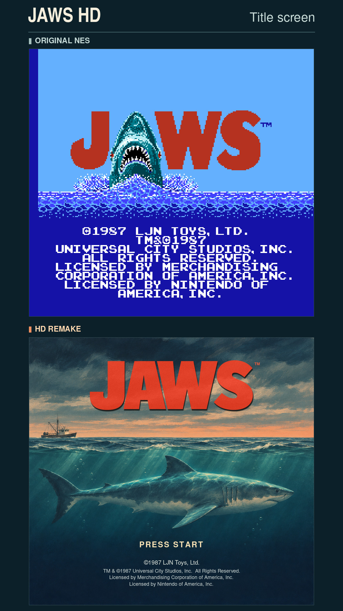
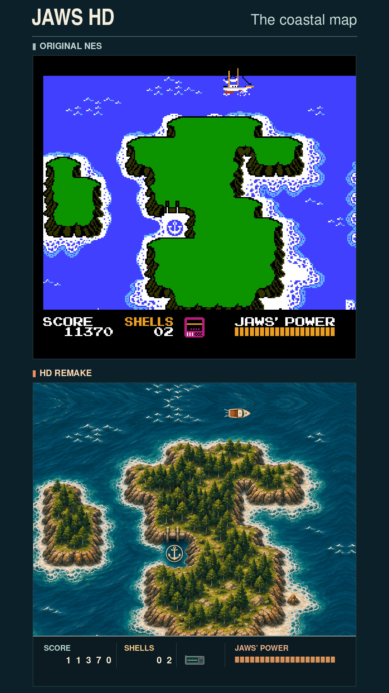
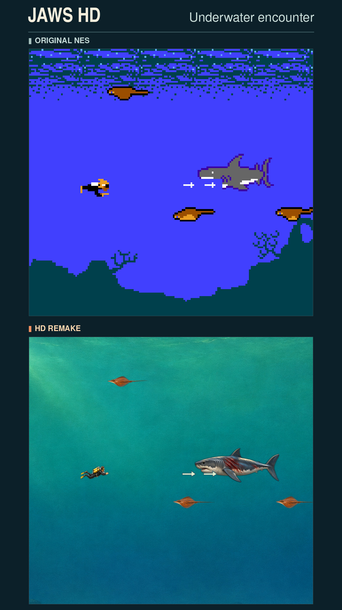
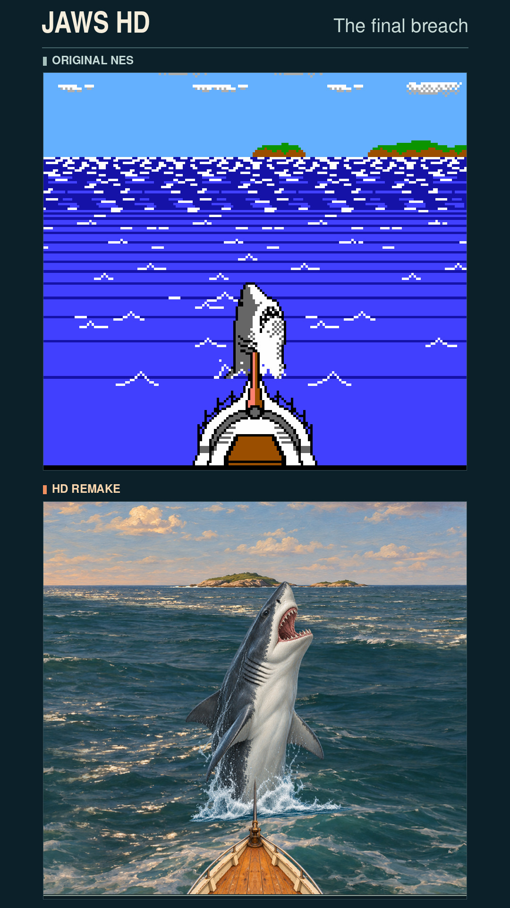

# Jaws HD

A 4× graphics pack for the NES game *Jaws*, tested with MesenCE 2.2.1. Sail a painted coastal map, hunt Jaws underwater, and face his final breach at the bow.

**[Download Jaws HD v1.0.0](https://github.com/kgrant191/jaws-hd/releases/download/v1.0.0/Jaws_HD_v1.0.0.zip)** · [Release notes and downloads](https://github.com/kgrant191/jaws-hd/releases/tag/v1.0.0)

## Before and after

Each image shows the same gameplay frame with the original NES graphics above and the HD pack below. Select a comparison to see it at full size.

| Title screen | Coastal map |
| --- | --- |
|  |  |
| **Underwater encounter** | **Final breach** |
|  |  |

## Install

1. Download the install ZIP above and close the game in MesenCE.
2. Extract the `Jaws (USA)` folder into MesenCE’s `HdPacks` directory. When upgrading, replace the previous pack folder. The resulting path should be `HdPacks/Jaws (USA)/hires.txt`.
3. If your ROM has a different filename, rename the pack folder to match it without the `.nes` extension.
4. Enable NES HD packs and open your own *Jaws (USA)* ROM. The supported ROM has SHA-1 `C102DA80B2DED9364EBD707DF14CBC3BD40BD65A`.

## In the pack

- Animated map boat and wake, harbor arrivals, and a transceiver that pulses with the game’s signal.
- Divers, underwater enemies, spinning pickups, a piloted mini-sub, and the bonus-stage plane.
- All 34 map-fin poses, visible wounds at half health, and distinct artwork for the final leap and bow strike.
- Three jellyfish appearances in the default mixed mode. Optional single-style configurations are available in the repository and the source build.

## Rebuild

The `source/` directory contains the editable artwork, builder and instructions. [Build from source](source/README.md).

Unofficial fan project. Jaws and the original NES game belong to their respective rights holders. Supply your own ROM.
